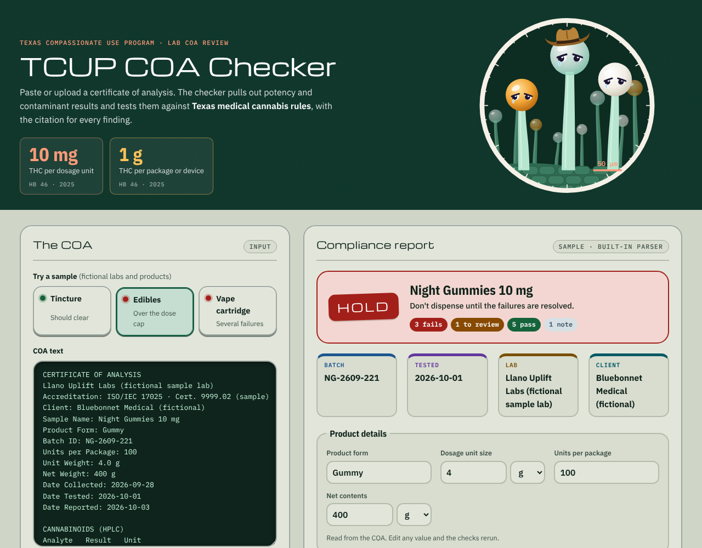
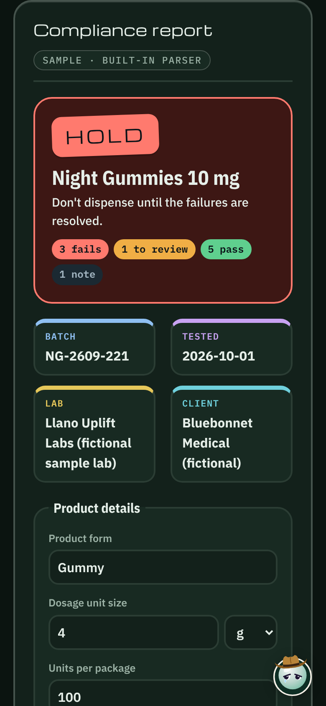

# TCUP COA Checker

**Live demo:** https://scenebiscuit-cell.github.io/tcup-coa-checker/

A browser tool that reads a cannabis lab **certificate of analysis (COA)** and checks it against the rules of the **Texas Compassionate Use Program (TCUP)**, the state's medical cannabis program. Every finding links to the statute or rule it comes from.



## Why I built it

Reviewing COAs is routine compliance work, and the problems tend to repeat: a missing test panel, a per-dose THC figure nobody calculated, a semi-synthetic cannabinoid on the potency table. This project combines my background in state cannabis compliance and enforcement with software. Software can do the tedious reading and math, while the compliance calls stay explicit and auditable.

## What it checks

| Check | Rule | Source |
|---|---|---|
| Required test panel: THC, CBD, residual solvents, pesticides, mold, heavy metals (fungicides and fertilizers flagged for review) | Every processed product must be tested for these | 37 TAC §12.7(b) |
| Contaminant results within limits | Each result is compared to the action limit printed on the COA | 37 TAC §12.7(b) |
| THC per dosage unit | No more than **10 mg** of tetrahydrocannabinols per dosage unit | Occ. Code §169.001(3), as amended by HB 46 (2025) |
| THC per package or device | No more than **1 g** of THC per package, container, or inhalation device | Health & Safety Code §487.107(c) (HB 46) |
| Phytocannabinoids only | Flags HHC, THC-O-acetate and similar, plus elevated Δ8-THC that suggests catalyst conversion | Health & Safety Code §487.1071 (HB 46) |
| Product form | Smokable products fail; inhaled products need a prescription and an approved device | Occ. Code §169.001, §169.006 |
| Traceability | Batch number and test date present to support the final label | 37 TAC §12.7(p) |

Each COA gets a verdict: **Clear**, **Review**, or **Hold**.

### Compliance details worth knowing

- **Total THC includes Δ8.** The statute caps "tetrahydrocannabinols," so the checker computes Δ9 + Δ8 + Δ10 + THCA × 0.877 instead of trusting the lab's printed total, which often leaves out Δ8.
- **The rule text is out of date.** Published copies of 37 TAC §12.7(q) still read 0.5% THC / 10% CBD by weight. HB 46 replaced that standard in statute with per-dose and per-package limits, and the checker applies the statute.
- **Units are reconciled.** Potency reported in %, mg/g, mg/mL, or mg per unit is converted to mg per dose and mg per package using the product's unit size and package contents.

## How it works

```
COA (paste / PDF / photo)  →  reader  →  structured fields  →  rules engine  →  verdict + cited findings
                               │                ↑
       built-in parser, or an AI model     user can correct any field
       (local via Ollama, or Claude)
```

The design keeps reading and judging apart. Reading a COA is the hard, fuzzy part, because every lab formats its report differently. An AI model handles that well. Judging compliance has to be consistent and explainable, so it stays in plain code with a citation on every finding. Self-checks sit in between: they compare the THC rows to the lab's printed total and flag impossible values, so a misread shows up as a finding instead of a wrong verdict.

- **`src/core.js`** has the COA parser and the rules engine. No state standardizes the COA layout, so the parser looks for patterns that recur across labs: "Label: value" fields (two to a line, or the value on the next line), pass/fail status under each test name, summary rows and grids, sideways cannabinoid tables, row tables with LOD/LOQ and several result columns, units in column headers, single-spaced text copied from a PDF viewer, CSV exports, and chemical names as well as abbreviations. These are pure functions with no DOM access, so they're easy to test. All pass/fail decisions are deterministic code, so the same COA always gets the same verdict.
- **`src/app.js`** is the interface: sample loading, PDF text extraction with pdf.js, the optional local-model reader, editable product details, and the report.
- **`src/samples.js`** has three fictional COAs that exercise the clear, review, and hold paths.
- **`tests/`** has 28 unit tests for the THC math, unit conversion, each sample's verdict, rebuilding PDF text, and fictional COAs in eight real-lab layouts (`tests/fixtures/`).

The public demo runs entirely in the browser, and nothing is uploaded. It accepts COA PDFs that contain text (most lab-issued PDFs) and extracts the text with pdf.js. Scanned or photographed COAs have no text layer and need the AI version. A version of this tool runs inside Claude, where an AI model reads unfamiliar COA layouts, scanned PDFs, and photos into the same structured fields. The rules engine still makes every compliance call.

### The header

A microscope view of trichomes on the leaf surface, with smooth stalks and glossy resin heads in the clear, milky, and amber colors growers watch for, on a flat, film-grain forest green. The three tallest have eyes that follow the cursor and show each verdict: excited for Clear (rosy cheeks and sparkles), heavy skeptical eyelids for Review, sad eyes and a tear for Hold. The tall one wears a cowboy hat, since this checker is Texas-only. Once you scroll past the header, a small copy of it (same face, same hat) waits in the bottom corner, so you still see it react when a verdict changes. It takes the shape of the product being checked: an amber dropper bottle for tinctures, a gummy for edibles, and a 510 cartridge for vapes, with the same eyes and expressions. They're decorative, hidden from screen readers, and still for people who prefer reduced motion.

Each kind of lab test (cannabinoids, solvents, pesticides, microbials, metals, and more) gets its own color and a larger, bolder heading in the lab results, so a long COA is quicker to scan.

Below the header, the page is styled like a mid-century lab instrument (`src/retro.css`): enamel panels with chrome trim, capsule buttons, results on dark phosphor readout screens, and indicator lamps beside each finding. The period display face is kept to short titles so body text stays easy to read.

## Use a local AI model (Ollama)

The built-in parser covers simple and common lab layouts. For any layout, including scanned PDFs and phone photos, connect a model running on your own computer. The COA never leaves your machine.

1. Install [Ollama](https://ollama.com) and pull a model:
   ```bash
   ollama pull qwen2.5:14b      # text COAs and PDFs with text
   ollama pull qwen2.5vl:7b     # optional: scanned PDFs and photos
   ```
2. Allow the site to reach Ollama. This step isn't needed when you run the page from `http://localhost`. On Windows, in PowerShell:
   ```powershell
   setx OLLAMA_ORIGINS "https://scenebiscuit-cell.github.io"
   ```
   Then quit Ollama from the system tray and start it again. On macOS: `launchctl setenv OLLAMA_ORIGINS "https://scenebiscuit-cell.github.io"`, then restart Ollama.
3. On the page, open **Use a local AI model** and click **Connect**. If the browser asks to let the site reach apps on this device, allow it.

The page sends the COA text and a JSON schema to Ollama's `/api/chat`, streams the answer, and runs the same rules engine on the result. Reading time depends on your GPU and how many results the COA lists; the page shows progress as the model writes. Smaller local models misread more often than large hosted ones, which is why the self-checks and the "Lab results as read" table matter.

## Continue development

[docs/WORKFLOW.md](docs/WORKFLOW.md) is the everyday workflow: Claude Code in VS Code for changes and Copilot for autocomplete. Both read the same project rules (`CLAUDE.md` imports `.github/copilot-instructions.md`). [docs/HANDOFF.md](docs/HANDOFF.md) covers Copilot on its own. The repository includes Copilot instructions and reusable prompts for adding a lab layout, updating a rule, and syncing a new version. A GitHub Actions workflow runs the tests on every push.

## Run it locally

No build step and no dependencies.

```bash
git clone https://github.com/scenebiscuit-cell/tcup-coa-checker.git
cd tcup-coa-checker
npx serve .        # or: python3 -m http.server
npm test           # Node 18+
```



## Disclaimer

This is a portfolio prototype, not legal advice or a substitute for Texas DPS guidance. The sample COAs, labs, and companies are fictional. Rules reflect Texas law as of October 2026.

## Sources

- [37 TAC §12.7, Testing, Production, and Packaging](https://www.law.cornell.edu/regulations/texas/37-Tex-Admin-Code-SS-12-7)
- [HB 46 (89th Legislature), enrolled text](https://capitol.texas.gov/tlodocs/89R/billtext/html/HB00046F.htm)
- [Texas DPS: Summary of new laws impacting the Compassionate Use Program](https://www.dps.texas.gov/section/compassionate-use-program/89th-legislation)
- [Vicente LLP: TCUP overview (Jan. 2026)](https://vicentellp.com/insights/texas-compassionate-use-program-tcup-overview/)

---

Created by **Nick Lax** · nlaxatx@gmail.com · MIT License
